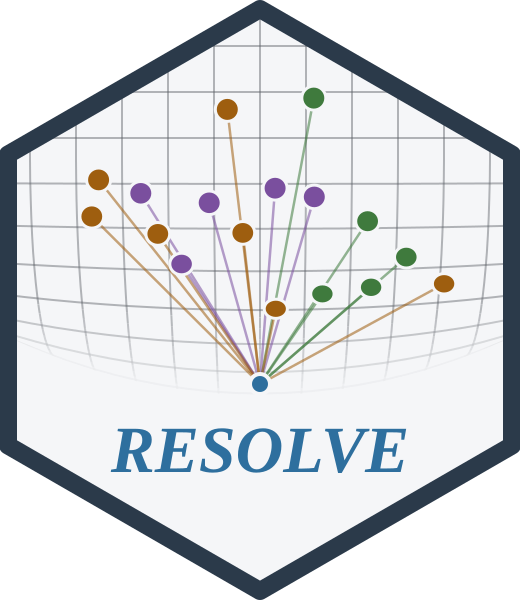
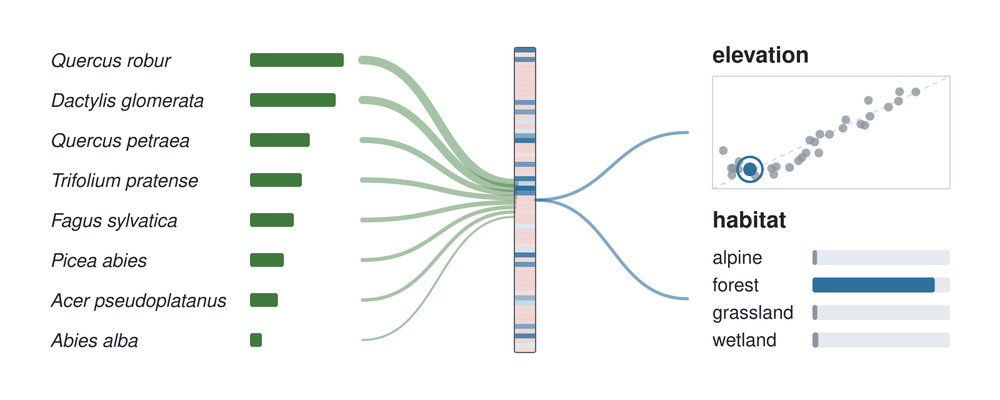

# RESOLVE 

*predicting sample attributes from the species or items observed in it*

<!-- badges: start -->
[](https://github.com/gcol33/resolve/actions/workflows/tests.yml)
[](https://pepy.tech/projects/resolve-core)
[](https://pepy.tech/projects/resolve-core)
[](https://github.com/gcol33/resolve/actions/workflows/r-cmd-check.yml)
[](https://gillescolling.com/resolve)
[](https://opensource.org/licenses/MIT)
[](https://www.python.org/downloads/)
<!-- badges: end -->

<p align="center">
  <picture>
    <source media="(prefers-color-scheme: dark)" srcset="docs/assets/hero-dark.svg">
    
  </picture>
</p>

RESOLVE predicts attributes of a sample from the set of things observed in it, such as the area, elevation or habitat type of a vegetation plot from its species list.

The engine is a C++ library on libtorch, the C++ core of [PyTorch](https://pytorch.org/); the Python package, the R package and the command line are bindings over it, so a model trained from one loads in any other. A sample's composition is a variable-length set, and the model pools the effect of each entity, weighted by its abundance, into one latent representation of the sample. Every target is read off that representation, so a continuous target and a categorical one are fitted together. The fit holds out a share of the samples and reports metrics per target, so you can compare encodings and inputs on your own data and choose the model to keep.

RESOLVE supports:

- **Several targets from one encoder.** Regression and classification heads share the latent representation. A target labelled on only some of the samples keeps the rest in the fit when its missing-label policy is set to mask ([Data Preparation](https://gillescolling.com/resolve/tutorials/data-preparation/)).
- **Five encodings of the species set.** Feature hashing, learned embeddings, an explicit abundance vector, rank pooling over shared species, genus and family tables, and a transformer over species tokens ([Encoding Modes](https://gillescolling.com/resolve/tutorials/encoding-modes/)).
- **Covariates, coordinates and taxonomy.** Numeric covariates, string covariates and coordinates enter the same encoder. Genus and family give a species the model never saw a fallback identity.
- **Pretraining without labels.** Joint-embedding, contrastive, variational and masked-species pretext tasks train the encoder on composition alone before a supervised fit.
- **Diagnostics on the held-out fold.** Residuals, class probabilities, calibration bins and cross-validation, with spatial blocks when the samples have coordinates, come off the trainer ([Training Models](https://gillescolling.com/resolve/tutorials/training/)).
- **GPU training.** The engine runs on CUDA when the installed torch has it, and a run that exhausts device memory halves its batch size and retries ([Performance Tuning](https://gillescolling.com/resolve/tutorials/performance-tuning/)).

Every interface calls the same compiled engine. The [tests workflow](https://github.com/gcol33/resolve/actions/workflows/tests.yml) builds the engine and runs its C++ tests, the command-line end-to-end tests and the Python binding tests on every push, and the R package goes through R CMD check. The feature-hashing encoder follows [Weinberger et al. (2009)](https://doi.org/10.1145/1553374.1553516) and the transformer encoder [Vaswani et al. (2017)](https://doi.org/10.48550/arXiv.1706.03762), which a methods section can cite alongside the package.

## Installation

Install the Python package from PyPI:

```bash
pip install resolve-core
```

The wheels cover CPython 3.10 to 3.13 on Linux x86-64, Windows x86-64 and macOS on Apple Silicon. They link the libtorch inside the `torch` package, which pip installs with them; on Linux and Windows the default PyPI torch is the CUDA build, on macOS the CPU build. Check the installed version:

```python
import resolve_core as rc

print(rc.__version__)
```

### Building from source

The source build needs CMake 3.18 or newer, a C++20 compiler and an installed torch, which CMake uses to locate libtorch. The project root is `src/core`:

```bash
git clone https://github.com/gcol33/resolve.git
cd resolve/src/core
pip install .
```

### Optional: CUDA kernels

Training on a GPU needs only the CUDA build of torch: set `device = "cuda"` on the training config and the engine runs through torch's CUDA operators. The PyPI wheels are built without the engine's own CUDA kernels. A source build with `USE_CUDA` on compiles the custom hash-embedding kernels with nvcc and enables the VRAM cap (`vram_fraction` on the training config), which stays a no-op without them. That build needs the CUDA toolkit; the kernels are compiled for compute capabilities 8.9 and 12.0 by default, and `RESOLVE_CUDA_ARCHITECTURES` selects others:

```bash
pip install . -C cmake.define.USE_CUDA=ON
```

### R

The R package installs without the engine and downloads a prebuilt backend library afterwards:

```r
# install.packages("pak")
pak::pak("gcol33/resolve/r")

library(resolveR)
resolve.install_backend()                  # CPU
resolve.install_backend(variant = "cuda")
```

The [resolveR site](https://gillescolling.com/resolve/r/) documents the R interface.

### Command line

The `resolve` executable is built by the same CMake project:

```bash
cd resolve/src/core
cmake -B build -DBUILD_CLI=ON -DBUILD_TESTS=OFF -DBUILD_PYTHON=OFF
cmake --build build
./build/bin/resolve version
```

## Usage

1. Name the sample and species columns of your two tables with `RoleMapping()`.
2. Declare each target with `TargetSpec`.
3. Load the tables with `ResolveDataset.from_pandas()`.
4. Build `ResolveModel()` from the dataset schema and fit it with `Trainer.fit()`.
5. Save the checkpoint with `Trainer.save()` and score tables with `Predictor.predict_dataset()`.

The example builds 120 synthetic plots whose target `y` is the sum of a fixed value per species, so a model that learns the composition recovers it:

```python
import math
import pandas as pd
import resolve_core as rc

values = {f"sp{s}": math.sin(s * 1.7) * 2.0 for s in range(12)}
header, species = [], []
for i in range(120):
    picks = [(i + k * (i // 12 + 1)) % 12 for k in range(3)]
    header.append({"plot": f"P{i}", "y": sum(values[f"sp{s}"] for s in picks)})
    species += [{"plot": f"P{i}", "species": f"sp{s}"} for s in picks]
plots = pd.DataFrame(header)
records = pd.DataFrame(species)

roles = rc.RoleMapping()
roles.plot_id = "plot"
roles.species_id = "species"

targets = [rc.TargetSpec.regression("y")]
dataset = rc.ResolveDataset.from_pandas(plots, records, roles, targets)

model = rc.ResolveModel(dataset.schema)
trainer = rc.Trainer(model, rc.TrainConfig())
trainer.prepare_data(dataset)
result = trainer.fit()
result.final_metrics
```

The fit returns a `TrainResult`, and `final_metrics` holds, per target, the mean absolute error, root mean square error, R², symmetric mean absolute percentage error and the share of held-out predictions within 10, 25 and 50 % of the truth. The checkpoint saved with `trainer.save("model.pt")` loads into a `Predictor`, whose `predict_dataset()` returns one prediction per sample for every target.

The input is two [pandas](https://pandas.pydata.org/) data frames: a header table with one row per sample, holding the targets and any covariates and coordinates, and a species table with one row per observation of an entity in a sample. The roles map your column names onto the sample identifier, the species identifier and the optional abundance, coordinates, genus, family and covariate columns. The same tables are read from disk with `ResolveDataset.from_csv()`, and a single long table with the targets repeated per row with `ResolveDataset.from_species_csv()`. A sample missing a target label is dropped by default; the `missing` field of its target keeps it and fits it on its other targets ([Data Preparation](https://gillescolling.com/resolve/tutorials/data-preparation/)).

## Encoding the species set

The species set is encoded before the sample encoder sees it, and the mode is set on the dataset config:

| Mode | What it encodes |
|------|-----------------|
| `Hash` | Feature hashing over the full entity list, with a fixed width regardless of vocabulary size |
| `Embed` | Learned embeddings for the dominant entities |
| `Sparse` | An explicit abundance vector over the known vocabulary |
| `RankPool` | Shared species, genus and family tables, pooled by an abundance-weighted mean |
| `Transformer` | Additive species tokens with self-attention and attention or CLS pooling |

```python
cfg = rc.DatasetConfig()
cfg.species_encoding = rc.SpeciesEncodingMode.RankPool
cfg.pool_weighting = rc.PoolWeighting.Log1p
```

Above the species encoder, the sample encoder is chosen on the model config: a multilayer perceptron, FT-Transformer, TabNet, SAINT, ExcelFormer, TraitNet or a graph encoder over a spatial, taxonomic or co-occurrence graph. [Encoding Modes](https://gillescolling.com/resolve/tutorials/encoding-modes/) describes each mode and when it fits.

## Covariates, coordinates and taxonomy

Coordinates, numeric covariates and string covariates join the composition in the same encoder, and genus and family give an entity a fallback identity:

```python
roles.latitude = "Latitude"
roles.longitude = "Longitude"
roles.genus = "Genus"
roles.family = "Family"
roles.covariates = ["elevation", "slope"]
roles.categoricals = ["bedrock", "country"]
```

String columns are factorised at load time into their own embedding tables, and the vocabularies travel in the checkpoint, so a raw table scores against the codes the model trained on. An entity the model never saw is encoded on a reserved unknown row and the sample still gets a prediction; the share of its abundance from such entities and their count are encoder inputs. [Data Preparation](https://gillescolling.com/resolve/tutorials/data-preparation/) lists every role and what the loader does with missing values.

## Reading the fit

The held-out fold stays reachable from the trainer, with per-sample output for both task types and the sample identifiers to join any of it back to your table:

```python
resid = trainer.compute_residuals("y")
trainer.test_plot_ids()
trainer.compute_calibration("Habitat")
trainer.cross_validate(n_folds=5)
```

Latent representations come off a fitted predictor and can be clustered, projected or passed to another model, and the learned species embeddings are read from the same object:

```python
pred = rc.Predictor.load("model.pt")
out = pred.predict_dataset(dataset, return_latent=True)
out.latent
pred.get_species_embeddings()
```

[Training Models](https://gillescolling.com/resolve/tutorials/training/) covers the held-out fold and cross-validation; [Understanding Embeddings](https://gillescolling.com/resolve/tutorials/embeddings/) covers the latent and species spaces.

## Pretraining without labels

Labelled samples are usually the scarce part. Self-supervised pretext tasks train the encoder on composition alone, then the weights go into a supervised fit:

```python
continuous = dataset.continuous_block(True)
jepa = rc.JEPAPretrainer(model, rc.PretrainConfig())
jepa.pretrain(continuous,
              genus_ids=dataset.genus_ids,
              family_ids=dataset.family_ids,
              species_ids=dataset.species_ids,
              categorical_ids=dataset.categorical_ids)
```

`SCARFPretrainer` applies contrastive corruption, `VAEPretrainer` variational reconstruction of the species vector, and `MaskedSpeciesPretrainer` predicts masked species from the rest of the plot for a transformer encoder. Every pretext view corrupts every input the encoder reads, the species identifiers, pool tensors and categorical covariates included.

## Command line and R

The command line runs the engine without a language runtime:

```bash
resolve train --header plots.csv --species species.csv \
              --plot-id PlotID --species-id Species --abundance Cover \
              --target Area:regression --target Habitat:classification:9 \
              --device cuda --output model.pt

resolve predict --model model.pt --header new_plots.csv \
                --species new_species.csv --output predictions.csv

resolve info --model model.pt
```

The R package reaches the same engine through a C ABI, so it needs no libtorch headers of its own:

```r
library(resolveR)

dataset <- resolve.dataset.csv(
  header  = "plots.csv",
  species = "species.csv",
  roles   = list(plot_id = "PlotID", species_id = "Species", abundance = "Cover"),
  targets = list(
    area    = list(column = "Area", task = "regression", transform = "log1p"),
    habitat = list(column = "Habitat", task = "classification", num_classes = 9)
  )
)

trainer   <- resolve.train.dataset(dataset, maxEpochs = 200L, savePath = "model.pt")
predictor <- resolve.load("model.pt")
preds     <- resolve.predict.dataset(predictor, dataset)
```

## Samples outside ecology

The input shape is a sample and the set of things observed in it, which other fields share:

| Field | Entities | Sample | Predictions |
|-------|----------|--------|-------------|
| Ecology | Plant species | Vegetation plot | Plot area, habitat type, elevation |
| Medicine | Symptoms, conditions | Patient | Diagnosis, severity, treatment response |
| Retail | Products | Basket | Customer segment, churn risk |
| Genomics | Genes, variants | Sample | Phenotype, disease risk |
| Text | Words, n-grams | Document | Topic, sentiment, author |

The role names carry the ecological vocabulary the package grew up with; `plot_id` and `species_id` point at whichever columns identify the sample and the entity.

## Training on a GPU

The engine uses CUDA when the installed torch has it. A run that exhausts device memory releases the caches, halves the batch size and restarts, down to a floor you set. On a GPU shared with a desktop, `vram_fraction` leaves headroom for the compositor in a build with the CUDA kernels ([Optional: CUDA kernels](#optional-cuda-kernels)):

```python
cfg = rc.TrainConfig()
cfg.device = "cuda"
cfg.batch_size = 16384
cfg.vram_fraction = 0.80
```

[Performance Tuning](https://gillescolling.com/resolve/tutorials/performance-tuning/) covers learning rate, batch size, mixed precision and the GPU settings.

## Documentation

Start with [Quick Start](https://gillescolling.com/resolve/tutorials/quickstart/): one path from two CSV files to a saved model and its predictions, in Python, R and on the command line.

- [Installation](https://gillescolling.com/resolve/tutorials/installation/): requirements, the source build, the R backend and the CLI build.
- [Data Preparation](https://gillescolling.com/resolve/tutorials/data-preparation/): the two tables, roles, targets, missing values and reusing a training vocabulary.
- [Training Models](https://gillescolling.com/resolve/tutorials/training/): the configuration structs, results, the held-out fold, cross-validation and checkpoints.
- [Encoding Modes](https://gillescolling.com/resolve/tutorials/encoding-modes/): the five species encodings and the sample encoders.
- [Performance Tuning](https://gillescolling.com/resolve/tutorials/performance-tuning/): learning rate, batch size, mixed precision and GPU settings.
- [Making Predictions](https://gillescolling.com/resolve/tutorials/prediction/): loading a model, output formats, new species and batch scoring.
- [Understanding Embeddings](https://gillescolling.com/resolve/tutorials/embeddings/): the latent and species spaces.
- [API Reference](https://gillescolling.com/resolve/api/dataset/): the dataset, model, trainer and predictor classes.
- [resolveR](https://gillescolling.com/resolve/r/): the R package.

## Getting help

Questions and bug reports go to the [GitHub issues](https://github.com/gcol33/resolve/issues). A bug report is easiest to act on with a small reproducible example and the output of `resolve_core.__version__`.

## Contributing

Pull requests are welcome; see the [contributing guide](https://github.com/gcol33/resolve/blob/master/CONTRIBUTING.md).

## Support

> "Software is like sex: it's better when it's free." — Linus Torvalds

I'm a PhD student who builds packages in my free time because I believe good tools should be free and open. I started these projects for my own work and figured others might find them useful too.

If this package saved you some time, buying me a coffee is a nice way to say thanks. It helps with my coffee addiction.

[](https://buymeacoffee.com/gcol33)

## License

RESOLVE is licensed under MIT (see [LICENSE.md](LICENSE.md)).

## Citation

If you use this software, please cite it as below. `CITATION.cff` in the repository is the source; GitHub's "Cite this repository" button exports it as APA or BibTeX.

```text
Colling G. (2026). RESOLVE: Representation Encoding for Structured Observation Learning with Vector Embeddings (version 1.0.3). URL: https://gillescolling.com/resolve
```

BibTeX:

```bibtex
@misc{colling2026resolve,
  author = {Colling, Gilles},
  title  = {RESOLVE: Representation Encoding for Structured Observation Learning with Vector Embeddings},
  year   = {2026},
  month  = {10},
  url    = {https://gillescolling.com/resolve}
}
```
