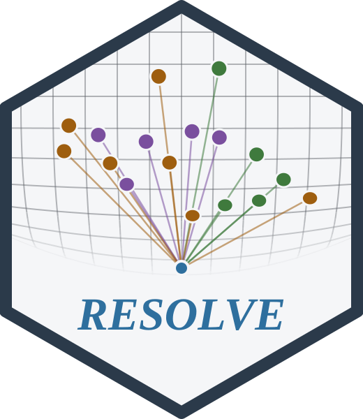
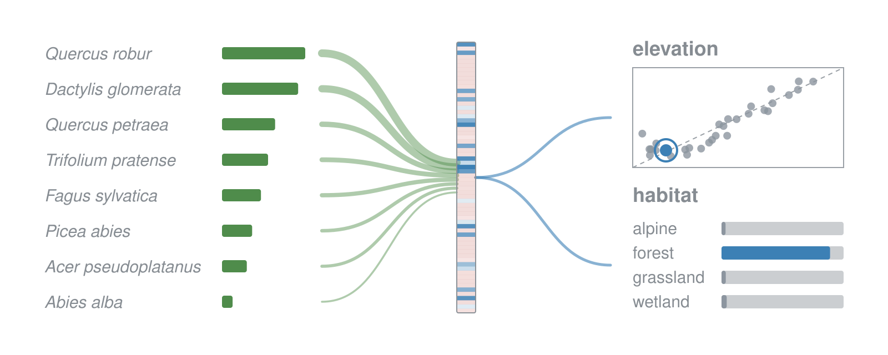

# RESOLVE 

*predicting sample attributes from the species or items observed in it*

<!-- badges: start -->

[](https://github.com/gcol33/resolve/actions/workflows/r-cmd-check.yml)
[](https://github.com/gcol33/resolve/actions/workflows/tests.yml)
[](https://pypi.org/project/resolve-core/)
[](https://pepy.tech/projects/resolve-core)
[](https://pepy.tech/projects/resolve-core)
[](https://opensource.org/licenses/MIT)
<!-- badges: end -->

<p align="center">


</p>

RESOLVE predicts attributes of a sample from the set of things observed
in it, such as the area, elevation or habitat type of a vegetation plot
from its species list.

A sample’s composition is a variable-length set, and the model pools the
effect of each entity, weighted by its abundance, into one latent
representation of the sample. Every target is read off that
representation, so a continuous target and a categorical one are fitted
together. The fit holds out a share of the samples and reports metrics
per target, so you can compare encodings and inputs on your own data and
choose the model to keep.

RESOLVE lets you:

- **Predict several targets from one encoder.** Regression and
  classification targets share the latent representation. A target
  labelled on only some of the samples keeps the rest in the fit when
  its missing labels are masked.
- **Encode the species set five ways.** Feature hashing, learned
  embeddings, an explicit abundance vector, rank pooling over shared
  species, genus and family tables, and a transformer over species
  tokens.
- **Add covariates, coordinates and taxonomy.** Numeric covariates,
  string covariates and coordinates enter the same encoder. Genus and
  family give a species the model never saw a fallback identity.
- **Pretrain without labels.** Self-supervised tasks train the encoder
  on composition alone before a supervised fit.
- **Score with several models at once.** A model suite combines trained
  models and reports, per sample, the combined prediction and how far
  the models agree.
- **Use R, Python or the command line.** The engine is a C++ library on
  libtorch, the C++ core of [PyTorch](https://pytorch.org/), and the R
  package, the Python package and the `resolve` executable are bindings
  over it, so a model trained from one loads in any other.

The [tests
workflow](https://github.com/gcol33/resolve/actions/workflows/tests.yml)
builds the engine and runs its C++ tests, the command-line end-to-end
tests and the Python binding tests on every push, and the R package goes
through R CMD check. The feature-hashing encoder follows [Weinberger et
al. (2009)](https://doi.org/10.1145/1553374.1553516) and the transformer
encoder [Vaswani et
al. (2017)](https://doi.org/10.48550/arXiv.1706.03762). Cite the RESOLVE
version to identify the implementation and defaults used in an analysis.

## Installation

### R

The R package, resolveR, compiles a small C++ interface when it is
installed from GitHub, so it needs a compiler:

| Operating system | Build tools |
|----|----|
| Windows | [Rtools](https://cran.r-project.org/bin/windows/Rtools/) matching your R version |
| macOS | Run `xcode-select --install` in Terminal |
| Debian / Ubuntu | Install `r-base-dev` |

Check that R finds them:

``` r
pkgbuild::has_build_tools(debug = TRUE)
```

Then install from GitHub:

``` r
# install.packages("pak")
pak::pak("gcol33/resolve/r")
```

### The engine in R

The engine is a shared library that bundles libtorch and is not compiled
into the package. `resolve.install_backend()` downloads a prebuilt build
into the package’s user data directory once, and `resolve.available()`
reports whether it is loaded:

``` r
library(resolveR)
resolve.install_backend()
resolve.available()
```

`resolve.install_backend(variant = "cuda")` installs the GPU build
instead, on Windows and Linux x86-64. It picks the CUDA 12.8 or CUDA 13
line from the installed NVIDIA driver and downloads the matching
libtorch (2 to 4 GB) from PyTorch’s server. Training then runs on the
card with `device = "cuda"`.

### Python

The Python package needs [Python](https://www.python.org/downloads/)
3.10 to 3.13:

``` bash
pip install resolve-core
```

The wheels cover Linux x86-64, Windows x86-64 and macOS on Apple
Silicon. They link the libtorch inside the `torch` package, which pip
installs with them. On Linux the default PyPI torch is the CUDA build;
on Windows and macOS it is the processor build, and the CUDA build on
Windows comes from PyTorch’s own index, as set up in [Installing the
engine](https://gillescolling.com/resolve/articles/installation.html).
Check what loaded with:

``` bash
python -c "import resolve_core, torch; print(resolve_core.__version__, torch.cuda.is_available())"
```

### Command line

The `resolve` executable builds from the engine’s CMake project, as set
up in [Installing the
engine](https://gillescolling.com/resolve/articles/installation.html).

## Usage

1.  Prepare two tables: a header table with one row per sample and its
    targets, and a species table with one row per species observed in a
    sample.
2.  Name the columns with `roles`, declare each target, and load the
    tables with `resolve.dataset.frame()` or `resolve.dataset.csv()`.
3.  Fit the model with `resolve.train.dataset()` and read its metrics on
    the held-out plots.
4.  Save it with `resolve.save()`, then load it with `resolve.load()`
    and predict with `resolve.predict.dataset()`.

This example uses the survey that ships with the package: 150 plots in
the Alps, their 638 species records and each plot’s elevation and
habitat.

``` r
library(resolveR)

plots <- read.csv(system.file("extdata", "plots.csv", package = "resolveR"))
species <- read.csv(system.file("extdata", "species.csv", package = "resolveR"))

dataset <- resolve.dataset.frame(
  header = plots,
  species = species,
  roles = list(plot_id = "plot_id", species_id = "species", abundance = "cover"),
  targets = list(
    elevation = list(column = "elevation", task = "regression"),
    habitat = list(column = "habitat", task = "classification")
  )
)

fit <- resolve.train.dataset(dataset, verbose = FALSE)
metrics <- fit$result$final_metrics
round(unlist(metrics$elevation[c("mae", "r2")]), 3)
#>     mae      r2 
#> 294.586   0.587
round(metrics$habitat$accuracy, 3)
#> [1] 0.633
```

Training holds out 20 % of the plots and stops when their loss no longer
improves; the metrics are computed on these plots, the mean absolute
error (`mae`) in metres. `resolve.save(fit$trainer, "model.pt")` writes
a checkpoint that carries the species vocabulary, so
`resolve.predict.dataset()` encodes a new table against the species the
model was trained on.

The same run in Python:

``` python
import pandas as pd
import resolve_core as rc

data = "https://raw.githubusercontent.com/gcol33/resolve/master/r/inst/extdata/"
plots = pd.read_csv(data + "plots.csv")
species = pd.read_csv(data + "species.csv")

roles = rc.RoleMapping()
roles.plot_id = "plot_id"
roles.species_id = "species"
roles.abundance = "cover"

targets = [rc.TargetSpec.regression("elevation"),
           rc.TargetSpec.classification("habitat", 4)]
dataset = rc.ResolveDataset.from_pandas(plots, species, roles, targets)

model = rc.ResolveModel(dataset.schema, rc.model_config_for_dataset(dataset))
trainer = rc.Trainer(model, rc.TrainConfig())
trainer.prepare_data(dataset)
result = trainer.fit()
result.final_metrics
```

## Encoding the species set

The species set is encoded before the sample encoder sees it: feature
hashing (`"hash"`), learned embeddings of the most abundant species
(`"embed"`), an abundance vector over the vocabulary (`"sparse"`),
species, genus and family tables pooled by an abundance-weighted mean
(`"rank_pool"`), or species tokens with self-attention
(`"transformer"`). The mode is set in the dataset’s `config`, as
`config = list(species_encoding = "rank_pool")`. Above it, the sample
encoder can be a multilayer perceptron, FT-Transformer, TabNet, SAINT,
ExcelFormer, TraitNet or a graph network. [Encoding the species
set](https://gillescolling.com/resolve/articles/encoding.html) compares
the modes on the survey.

## Reading the fit

The trainer keeps the held-out plots and gives per-plot residuals, class
probabilities and calibration bins, and `resolve.cross_validate()`
refits the model on each of k folds, with spatial blocks when the plots
have coordinates. A predictor also returns each plot’s latent
representation, to cluster, project or pass to another model. [Training
and reading the
fit](https://gillescolling.com/resolve/articles/training.html) covers
the settings and the held-out fold, and [Latent and species
embeddings](https://gillescolling.com/resolve/articles/embeddings.html)
the latent space.

## Large data and GPUs

The engine runs on CUDA when its build has it. A run that exhausts
device memory halves its batch size and retries, and an interrupted run
resumes from its last checkpoint. [Large data and
GPUs](https://gillescolling.com/resolve/articles/performance.html)
covers batch size, learning-rate schedules, mixed precision and the
memory settings, and [The command
line](https://gillescolling.com/resolve/articles/command-line.html)
trains and predicts without R or Python.

## Documentation

Start with [Predicting plot attributes from species
lists](https://gillescolling.com/resolve/articles/resolveR.html): one
path from two tables to a trained model and its predictions. Every code
block has an R and a Python version, and the [Python view of Get
started](https://gillescolling.com/resolve/articles/resolveR.html?lang=python)
opens with Python selected.

- [Preparing the two
  tables](https://gillescolling.com/resolve/articles/data-preparation.html):
  roles, targets, missing values and reusing a training vocabulary.
- [Encoding the species
  set](https://gillescolling.com/resolve/articles/encoding.html): the
  five encodings and the sample encoders.
- [Training and reading the
  fit](https://gillescolling.com/resolve/articles/training.html):
  training settings, the held-out fold, cross-validation and
  checkpoints.
- [Predicting new
  plots](https://gillescolling.com/resolve/articles/prediction.html):
  output formats, class probabilities, new species and model suites.
- [Latent and species
  embeddings](https://gillescolling.com/resolve/articles/embeddings.html):
  the latent space and the learned species tables.
- [Large data and
  GPUs](https://gillescolling.com/resolve/articles/performance.html) and
  [The command
  line](https://gillescolling.com/resolve/articles/command-line.html):
  scaling a run up.
- [Installing the
  engine](https://gillescolling.com/resolve/articles/installation.html):
  the GPU builds, building from source and the command line.
- [R reference](https://gillescolling.com/resolve/reference/index.html)
  and [Python
  reference](https://gillescolling.com/resolve/articles/python-reference.html):
  every function and class, grouped by job.

## Getting help

Questions and bug reports go to the [GitHub
issues](https://github.com/gcol33/resolve/issues). A bug report is
easiest to act on with a small reproducible example, for instance made
with [reprex](https://reprex.tidyverse.org/), and the output of
`resolve.version()` or `resolve_core.__version__`.

## Contributing

Building from a checkout and the test suites are in
[CONTRIBUTING.md](https://github.com/gcol33/resolve/blob/master/CONTRIBUTING.md).

## Support

> “Software is like sex: it’s better when it’s free.” — Linus Torvalds

I’m a PhD student who builds R packages in my free time because I
believe good tools should be free and open. I started these projects for
my own work and figured others might find them useful too.

If this package saved you some time, buying me a coffee is a nice way to
say thanks. It helps with my coffee addiction.

[](https://buymeacoffee.com/gcol33)

## License

RESOLVE is licensed under MIT.

## Citation

If you use RESOLVE, please cite it as below.

``` text
Colling G (2026). _resolveR: Predicting Sample Outcomes from
Compositional Data_. R package version 1.0.3,
<https://github.com/gcol33/resolve>.
```

BibTeX:

``` bibtex
@Manual{colling2026resolver,
  title = {resolveR: Predicting Sample Outcomes from Compositional Data},
  author = {Gilles Colling},
  year = {2026},
  url = {https://github.com/gcol33/resolve},
  note = {R package version 1.0.3},
}
```

Download the citation as
[BibTeX](https://gillescolling.com/resolve/resolveR.bib) or
[RIS](https://gillescolling.com/resolve/resolveR.ris).
