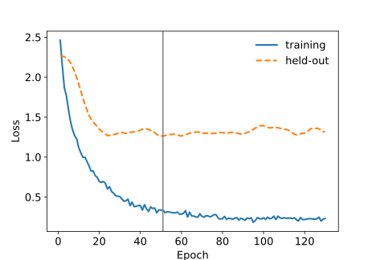

<!-- Python blocks run by tools/python_twins.py (md5 7070aabecab90c1fac629bf96a9703a6). -->

```{r setup, include = FALSE}
knitr::opts_chunk$set(collapse = TRUE, comment = "#>", fig.width = 6.5, fig.height = 4.5,
                      dev.args = list(pointsize = 14))
library(resolveR)
if (nzchar(Sys.getenv("RESOLVE_DOCS_CACHE"))) source(Sys.getenv("RESOLVE_DOCS_CACHE"))
if (resolve.available()) resolve.manual_seed(42)
```

Training fits a model to a dataset: it holds out part of the plots, adjusts the network on the rest and stops when its predictions on the held-out plots no longer improve. This article covers the settings a run takes, what the run returns and how to read the fit on the plots it did not train on.

It also covers the ways a run can be shaped: resuming an interrupted run, refitting on every plot for a fixed number of epochs, stopping on a fold you name, learning-rate schedules, the loss, the encoder architectures, cross-validation and checkpoints. Running on a GPU and on large data is the subject of [Large data and GPUs](performance.html).

## Installation

::: {.lang-pair}
```{r, eval = FALSE}
# install.packages("pak")
pak::pak("gcol33/resolve/r")

# The engine library, downloaded once
library(resolveR)
resolve.install_backend()
```

```bash
pip install resolve-core
```
:::

## The survey

The examples use the survey that ships with the R package: 150 plots in the Alps, with their elevation in metres and their habitat, and the species recorded on each plot with its genus, family and cover. The *roles* name the columns of the two tables, and each *target* is a column to predict. Elevation is a regression target and habitat a classification target with four classes.

::: {.lang-pair}
```{r data}
plots <- read.csv(system.file("extdata", "plots.csv", package = "resolveR"))
species <- read.csv(system.file("extdata", "species.csv", package = "resolveR"))

roles <- list(plot_id = "plot_id", species_id = "species",
              abundance = "cover", genus = "genus", family = "family")
targets <- list(
  elevation = list(column = "elevation", task = "regression"),
  habitat = list(column = "habitat", task = "classification")
)
dataset <- resolve.dataset.frame(plots, species, roles = roles,
                                 targets = targets)
dataset$n_plots()
```

```python
import pandas as pd
import resolve_core as rc

data = "https://raw.githubusercontent.com/gcol33/resolve/master/r/inst/extdata/"
plots = pd.read_csv(data + "plots.csv")
species = pd.read_csv(data + "species.csv")

roles = rc.RoleMapping()
roles.plot_id = "plot_id"
roles.species_id = "species"
roles.abundance = "cover"
roles.genus = "genus"
roles.family = "family"

targets = [rc.TargetSpec.regression("elevation"),
           rc.TargetSpec.classification("habitat", 4)]
dataset = rc.ResolveDataset.from_pandas(plots, species, roles, targets)
dataset.n_plots
#> 150
```
:::

[Preparing the two tables](data-preparation.html) covers every role and target setting.

## Three groups of settings

A run is described by three groups of settings, each owning one stage:

| Group | Decides |
|-------|---------|
| dataset settings | how the species set is encoded when the data is loaded |
| model settings | the network built on top of that encoding |
| training settings | the optimizer, the schedule, the loss, the precision and the device |

The dataset settings are passed when the data is loaded, as `config` of `resolve.dataset.frame()` in R and as a `DatasetConfig` in Python; [Encoding the species set](encoding.html) covers them. The model sizes its input layers from the dataset, so the fields that depend on the encoding (the encoding itself, the hash width, the species budget) come from the data.

::: {.lang-r-only}
In R, `resolve.train.dataset()` takes the common model and training settings as named arguments in camelCase (`maxEpochs`, `hiddenDims`, `lrScheduler`). Every other field goes into the `modelConfig` and `trainConfig` lists, under its snake_case name (`list(weight_decay = 1e-4)`). A field given both ways is an error, and so is a name the engine does not know. `resolve.default_config("train")` and `resolve.default_config("model")` list every field with its default.
:::

::: {.lang-py-only}
In Python, the model settings are a `ModelConfig` and the training settings a `TrainConfig`. Each starts at the engine's defaults; set a field by assigning to it. `rc.model_config_for_dataset(dataset, model_config)` copies the fields that depend on the encoding from the dataset into a `ModelConfig`; build every model through it.
:::

::: {.lang-pair}
```{r defaults}
defaults <- resolve.default_config("train")
str(defaults[c("batch_size", "max_epochs", "patience", "lr", "weight_decay")])
```

```python
cfg = rc.TrainConfig()
{name: round(getattr(cfg, name), 6)
 for name in ["batch_size", "max_epochs", "patience", "lr", "weight_decay"]}
#> {'batch_size': 4096, 'max_epochs': 500, 'patience': 50, 'lr': 0.001, 'weight_decay': 0.0001}
```
:::

The training settings you are most likely to change:

| Field | R argument | Default | Meaning |
|-------|-----------|---------|---------|
| `batch_size` | `batchSize` | 4096 | Plots per optimizer step |
| `max_epochs` | `maxEpochs` | 500 | Upper limit on the number of epochs |
| `patience` | `patience` | 50 | Epochs without improvement before training stops |
| `fixed_epochs` | `fixedEpochs` | 0 | Run exactly this many epochs and keep the final weights; 0 stops early |
| `lr` | `lr` | 0.001 | Learning rate of the AdamW optimizer |
| `weight_decay` | in `trainConfig` | 0.0001 | Weight decay of the AdamW optimizer |
| `loss_config` | `lossConfig` | combined | Loss preset, see [The loss](#the-loss) |
| `lr_scheduler` | `lrScheduler` | none | Learning-rate schedule, see [The learning rate](#the-learning-rate) |
| `selection_metric` | `selectionMetric` | loss | The held-out value early stopping follows |
| `device` | `device` | cpu | `cpu`, `cuda` or `cuda:N` |
| `checkpoint_dir` | `checkpointDir` | empty | Directory the run writes checkpoints to; empty writes none |
| `checkpoint_every` | `checkpointEvery` | 0 | Also write `checkpoint_<N>.pt` every N epochs |

An *epoch* is one pass over the training plots. The precision, memory and GPU fields are covered in [Large data and GPUs](performance.html).

## Basic training

Training holds out a fraction of the plots, the *held-out fold* (20 % by default, drawn at random with a fixed seed), and trains on the rest. After every epoch it computes the loss on the held-out fold; when that loss has not improved for `patience` epochs, training stops and the weights of the best epoch are restored. A larger `patience` therefore never returns a worse model, only costs more epochs.

::: {.lang-pair}
```{r train}
fit <- resolve.train.dataset(dataset, maxEpochs = 200L, patience = 30L,
                             testSize = 0.2, seed = 42L, verbose = FALSE)
result <- fit$result
result$best_epoch
length(result$train_loss)
```

```python
model = rc.ResolveModel(dataset.schema, rc.model_config_for_dataset(dataset))
cfg = rc.TrainConfig()
cfg.max_epochs = 200
cfg.patience = 30
trainer = rc.Trainer(model, cfg)
trainer.prepare_data(dataset, test_size=0.2, seed=42)
result = trainer.fit()
result.best_epoch
#> 50
len(result.train_loss_history)
#> 130
```
:::

The model is built from the dataset's schema, so the width of its input layers and its output heads, one per target, follow the data. Preparing the data splits the plots into the training and the held-out fold and fits the scalers of the inputs and the regression targets on the training fold alone, so nothing about the held-out plots enters the fit. `best_epoch` counts from 0.

The loss histories hold one value per epoch, on the training and on the held-out fold. The held-out loss is the curve early stopping watches.

::: {.lang-pair}
```{r loss-curve, fig.alt = "Training and held-out loss by epoch."}
epochs <- seq_along(result$train_loss)
plot(epochs, result$train_loss, type = "l", lwd = 2,
     ylim = range(result$train_loss, result$test_loss),
     xlab = "Epoch", ylab = "Loss")
lines(epochs, result$test_loss, lwd = 2, lty = 2)
abline(v = result$best_epoch + 1, col = "grey50")
legend("topright", c("training", "held-out"), lty = 1:2, lwd = 2, bty = "n")
```

```{.python fig-alt="Training and held-out loss by epoch."}
import matplotlib.pyplot as plt

epochs = range(1, len(result.train_loss_history) + 1)
fig, ax = plt.subplots(figsize=(6.5, 4.5))
ax.plot(epochs, result.train_loss_history, lw=2, label="training");
ax.plot(epochs, result.test_loss_history, lw=2, ls="--", label="held-out");
ax.axvline(result.best_epoch + 1, color="grey");
ax.set_xlabel("Epoch");
ax.set_ylabel("Loss");
ax.legend(frameon=False);
```


:::

An epoch counts against `patience` only once the loss has reached the phase it will be in at the last epoch of `max_epochs`; [Phased regression loss](#phased-regression-loss) explains the phases. With the default schedule and `max_epochs` above 300, the first 300 epochs never stop a run. In the run above, with 200 epochs, patience starts counting at epoch 100, so the run trains for at least 130 epochs even when its best epoch comes earlier.

## Training results

The result of a run holds the best epoch, the wall time in seconds, the loss histories and the metrics of every target on the held-out fold.

::: {.lang-pair}
```{r metrics}
result$train_time_seconds > 0
round(unlist(result$final_metrics$elevation), 3)
round(unlist(result$final_metrics$habitat), 3)
```

```python
result.train_time_seconds > 0
#> True
{name: round(value, 3) for name, value in result.final_metrics["elevation"].items()}
#> {'band_25': 0.433, 'band_10': 0.333, 'mae': 260.756, 'rmse': 301.784, 'r2': 0.721, 'smape': 0.278, 'band_50': 0.867}
{name: round(value, 3) for name, value in result.final_metrics["habitat"].items()}
#> {'recall_1': 0.818, 'accuracy': 0.8, 'f1_2': 0.842, 'macro_f1': 0.796, 'precision_0': 0.75, 'weighted_f1': 0.794, 'f1_0': 0.857, 'recall_0': 1.0, 'precision_1': 0.818, 'f1_1': 0.818, 'precision_2': 0.8, 'recall_2': 0.889, 'precision_3': 0.8, 'recall_3': 0.571, 'f1_3': 0.667}
```
:::

### Metrics

Regression targets are scored in their original units; a target trained on a `log1p` scale is transformed back first.

| Key | Meaning |
|-----|---------|
| `mae` | Mean absolute error |
| `rmse` | Root mean squared error |
| `r2` | Coefficient of determination: the share of the variance the predictions explain |
| `smape` | Symmetric mean absolute percentage error, between 0 and 2 |
| `band_10`, `band_25`, `band_50` | Share of plots predicted within 10, 25 and 50 % of their value, one key per entry in `band_thresholds` |

Classification targets:

| Key | Meaning |
|-----|---------|
| `accuracy` | Share of plots assigned their recorded class |
| `macro_f1` | Mean of the per-class F1 scores, every class weighted equally |
| `weighted_f1` | Mean of the per-class F1 scores, each class weighted by its number of plots |
| `precision_<c>`, `recall_<c>`, `f1_<c>` | Per class |

The same metrics are available on their own, for predictions made elsewhere: `resolve_mae()`, `resolve_rmse()`, `resolve_r_squared()`, `resolve_smape()`, `resolve_band_accuracy()` and `resolve_accuracy()` in R ([reference](../reference/index.html)).

### Baselines

A run also scores a naive baseline for every target, so a metric can be read against something: the mean of the training fold for a regression target, its most frequent class for a classification target. `skill_score` is 1 minus the ratio of the model's mean squared error to the baseline's, and `accuracy_lift` is the model's accuracy minus the baseline's.

::: {.lang-pair}
```{r baselines}
elevation <- result$baselines$elevation
round(unlist(elevation[c("baseline_mae", "model_mae", "skill_score")]), 3)
habitat <- result$baselines$habitat
round(unlist(habitat[c("baseline_accuracy", "model_accuracy",
                       "accuracy_lift")]), 3)
```

```python
elevation = result.baselines["elevation"]
{"baseline_mae": round(elevation.baseline_mae, 3),
 "model_mae": round(elevation.model_mae, 3),
 "skill_score": round(elevation.skill_score, 3)}
#> {'baseline_mae': 531.731, 'model_mae': 260.756, 'skill_score': 0.765}
habitat = result.baselines["habitat"]
{"baseline_accuracy": round(habitat.baseline_accuracy, 3),
 "model_accuracy": round(habitat.model_accuracy, 3),
 "accuracy_lift": round(habitat.accuracy_lift, 3)}
#> {'baseline_accuracy': 0.367, 'model_accuracy': 0.8, 'accuracy_lift': 0.433}
```
:::

### Loss by target

A run with several targets trains them through one loss, the weighted sum of the loss of each target. The loss histories by target split both histories into the term each target contributes, one value per epoch, so they show which target drives the loss early stopping watches. Per epoch the terms add up to the total.

::: {.lang-pair}
```{r loss-by-target}
held_out <- result$test_loss_by_target
sapply(held_out, function(h) round(c(first = h[1], last = h[length(h)]), 3))
```

```python
{target: (round(history[0], 3), round(history[-1], 3))
 for target, history in result.test_loss_history_by_target.items()}
#> {'elevation': (0.88, 0.443), 'habitat': (1.391, 0.869)}
```
:::

A mixture of experts adds a load-balancing term to the training loss and TabNet a sparsity term; they belong to no target and sit in the auxiliary loss history (`train_aux_loss` in R, `train_aux_loss_history` in Python) under `moe` and `tabnet_sparsity`. With them, the training terms add up to the total. A batch with no labelled plot for a target whose missing labels are masked contributes 0 for that target.

## The learning rate

The learning rate scales each step of the optimizer. By default it stays at `lr` for the whole run. The step, cosine and linear schedules are laid out over `max_epochs`, so they need the length of the run in advance; [Large data and GPUs](performance.html) covers them.

### Lowering the rate on a plateau

The plateau schedule follows the held-out fold instead, the way PyTorch's `ReduceLROnPlateau` does: when the held-out value early stopping reads has not improved for more than `lr_plateau_patience` epochs, the rate is multiplied by `lr_plateau_factor`, down to `lr_min`. Paired with a larger `patience`, the rate drops on a short plateau and training stops on a longer one.

That held-out value is the loss by default. With the selection metric set to accuracy, it is the held-out accuracy of the dataset's one classification target, and the epoch of the highest accuracy is kept. The run below lowers the rate after 5 epochs without improvement and stops after 10, both on the accuracy.

::: {.lang-pair}
```{r plateau}
fit_plateau <- resolve.train.dataset(
  dataset, maxEpochs = 100L, verbose = FALSE,
  selectionMetric = "accuracy", lrScheduler = "plateau",
  lrPlateauFactor = 0.1, lrPlateauPatience = 5L,
  lrPlateauThreshold = 1e-4, patience = 10L
)
unique(signif(fit_plateau$result$lr, 3))
max(fit_plateau$result$selection) <= 1
```

```python
cfg = rc.TrainConfig()
cfg.max_epochs = 100
cfg.selection_metric = rc.SelectionMetric.Accuracy
cfg.lr_scheduler = rc.LRSchedulerType.ReduceOnPlateau
cfg.lr_plateau_factor = 0.1
cfg.lr_plateau_patience = 5
cfg.lr_plateau_threshold = 1e-4
cfg.patience = 10
model = rc.ResolveModel(dataset.schema, rc.model_config_for_dataset(dataset))
plateau = rc.Trainer(model, cfg)
plateau.prepare_data(dataset, test_size=0.2, seed=42)
plateau_result = plateau.fit()
sorted({float(f"{rate:.3g}") for rate in plateau_result.lr_history}, reverse=True)
#> [0.001, 0.0001]
max(plateau_result.selection_history) <= 1
#> True
```
:::

The rate history holds the rate each epoch trained at, and the selection history the held-out value of each epoch: here the accuracy, between 0 and 1.

An epoch counts against the rate only where it would count against `patience`, and not during the `lr_plateau_cooldown` epochs after a decay. With the default threshold of 0, an epoch improves exactly when early stopping says it does; a positive threshold asks for a relative improvement on the best value. The schedule needs a held-out fold, so it is refused when nothing is held out. Its state is part of every checkpoint a resumed run reads.

### Warming up the rate

A large transformer encoder trained at its full rate from the first step can collapse onto predicting one class. A *warmup* starts the rate near zero and raises it linearly over the first `warmup_steps` optimizer steps (or `warmup_epochs` epochs) to whatever the schedule sets; after it, the schedule runs as it would have. The linear schedule then lowers the rate at every step to `lr_min` at the end of `max_epochs`, the warmup-then-linear-decay schedule transformer encoders are often fine-tuned with.

::: {.lang-pair}
```{r warmup}
fit_warm <- resolve.train.dataset(dataset, maxEpochs = 100L, verbose = FALSE,
                                  lrScheduler = "linear", lrMin = 0,
                                  warmupEpochs = 10L)
round(fit_warm$result$lr[c(1, 5, 10, 50, 100)], 6)
```

```python
cfg = rc.TrainConfig()
cfg.max_epochs = 100
cfg.lr_scheduler = rc.LRSchedulerType.LinearDecay
cfg.lr_min = 0.0
cfg.warmup_epochs = 10
model = rc.ResolveModel(dataset.schema, rc.model_config_for_dataset(dataset))
warm = rc.Trainer(model, cfg)
warm.prepare_data(dataset, test_size=0.2, seed=42)
warm_result = warm.fit()
[round(warm_result.lr_history[epoch - 1], 6) for epoch in [1, 5, 10, 50, 100]]
#> [0.0001, 0.0005, 0.001, 0.000562, 0.0]
```
:::

The rate history holds the rate of each epoch's last step: it climbs over the first ten epochs and falls to zero at the hundredth. Epochs that begin inside the warmup count against neither `patience` nor a plateau, since their held-out values come from a rate still climbing; their held-out value can still be the best. The pretraining methods take the same warmup setting.

## The loss

### Loss presets

The loss preset decides how the loss of the regression targets is composed:

| Preset | Composition |
|--------|-------------|
| `mae` | Mean absolute error for the whole run |
| `smape` | Mean absolute error plus the symmetric mean absolute percentage error, from the first epoch |
| `combined` | The three phases below (default) |
| `nca` | The three phases for regression, plus the NCA term on classification targets |

Classification targets use cross-entropy under every preset.

### Phased regression loss

Under `combined`, the regression loss moves through three phases at `phase_boundaries`, by default epochs 100 and 300:

1. Up to the first boundary, the mean absolute error

    $$\mathcal{L}_\text{MAE} = \frac{1}{n} \sum_{i=1}^{n} |y_i - \hat{y}_i|$$

2. Up to the second boundary, the symmetric mean absolute percentage error joins it, which weighs an error relative to the size of the value

    $$\mathcal{L}_\text{SMAPE} = \frac{1}{n} \sum_{i=1}^{n} \frac{|y_i - \hat{y}_i|}{(|y_i| + |\hat{y}_i|)/2 + \epsilon}$$

3. After it, a hinge penalizes predictions whose ratio to the observed value leaves the band $[1 - \tau, 1 + \tau]$, with $\tau$ = `band_threshold` (default 0.25)

    $$\mathcal{L}_\text{band} = \frac{1}{n} \sum_{i=1}^{n} \max\left(0,\ \left|\frac{\hat{y}_i}{y_i} - 1\right| - \tau\right)$$

`band_threshold` is what training optimizes; `band_thresholds` only selects which band accuracies are reported. A shorter run reaches the later phases when you move the boundaries.

::: {.lang-pair}
```{r phases}
fit_phases <- resolve.train.dataset(
  dataset, maxEpochs = 100L, verbose = FALSE,
  trainConfig = list(phase_boundaries = c(30L, 60L), band_threshold = 0.25)
)
fit_phases$trainer$get_config()$phase_boundaries
```

```python
cfg = rc.TrainConfig()
cfg.max_epochs = 100
cfg.phase_boundaries = (30, 60)
cfg.band_threshold = 0.25
model = rc.ResolveModel(dataset.schema, rc.model_config_for_dataset(dataset))
phases = rc.Trainer(model, cfg)
phases.prepare_data(dataset, test_size=0.2, seed=42)
phases_result = phases.fit()
phases.config.phase_boundaries
#> (30, 60)
```
:::

### The NCA term

The `nca` preset adds the Neighbourhood Components Analysis (NCA) objective of Goldberger, Roweis, Hinton and Salakhutdinov (2004) to the cross-entropy of every classification target. Each plot draws a neighbour from the other plots of its batch with probability

$$p_{ij} = \frac{\exp(u_i \cdot u_j / T)}{\sum_{k \neq i} \exp(u_i \cdot u_k / T)}, \qquad p_{ii} = 0$$

over the head outputs $u$, scaled to unit length, and the term is $-\log \sum_{j \in C_i} p_{ij}$, with $C_i$ the plots of the same class, averaged over the plots that have a same-class neighbour in the batch. It pulls plots of the same class together and pushes plots of different classes apart on the unit sphere, which cross-entropy alone does not do.

Cross-entropy stays in the sum because the NCA term does not change when the head's output coordinates are permuted: it constrains which plots lie near each other and says nothing about which coordinate belongs to which class. On its own it would leave the predicted class, the coordinate with the largest output, without meaning.

Three settings tune it, and they act only under the `nca` preset:

- **`nca_temperature`** ($T$, default 0.1) sets how many neighbours each plot spreads its probability over.
- **`nca_neighbors`** (default 32) is the number of nearest plots in the batch the term sums over; 0 or less keeps the whole batch.
- **`nca_weight`** (default 0.1) scales the term against the cross-entropy it is added to.

::: {.lang-pair}
```{r nca}
fit_nca <- resolve.train.dataset(dataset, maxEpochs = 100L, verbose = FALSE,
                                 lossConfig = "nca", ncaTemperature = 0.2,
                                 ncaNeighbors = 16L, ncaWeight = 0.3)
round(fit_nca$result$final_metrics$habitat$accuracy, 3)
```

```python
cfg = rc.TrainConfig()
cfg.max_epochs = 100
cfg.loss_config = rc.LossConfigMode.NCA
cfg.nca_temperature = 0.2
cfg.nca_neighbors = 16
cfg.nca_weight = 0.3
model = rc.ResolveModel(dataset.schema, rc.model_config_for_dataset(dataset))
nca = rc.Trainer(model, cfg)
nca.prepare_data(dataset, test_size=0.2, seed=42)
round(nca.fit().final_metrics["habitat"]["accuracy"], 3)
#> 0.833
```
:::

## Refitting on every plot

Early stopping needs a held-out fold. To refit a validated configuration on all of the data, fix the number of epochs beforehand, for example the median best epoch over the validation runs, and hold nothing out. A `best_epoch` of `e` (counted from 0) corresponds to `e + 1` fixed epochs.

::: {.lang-pair}
```{r refit}
n_epochs <- fit$result$best_epoch + 1L
refit <- resolve.train.dataset(dataset, maxEpochs = 200L,
                               fixedEpochs = n_epochs, testSize = 0,
                               verbose = FALSE)
length(refit$result$train_loss) == n_epochs
length(refit$result$test_loss)
```

```python
n_epochs = result.best_epoch + 1
cfg = rc.TrainConfig()
cfg.max_epochs = 200
cfg.fixed_epochs = n_epochs
model = rc.ResolveModel(dataset.schema, rc.model_config_for_dataset(dataset))
refit = rc.Trainer(model, cfg)
refit.prepare_data(dataset, test_size=0.0, seed=42)
refit_result = refit.fit()
len(refit_result.train_loss_history) == n_epochs
#> True
len(refit_result.test_loss_history)
#> 0
```
:::

The refit has no held-out loss and no held-out metrics. Its learning-rate schedule is still laid out over `max_epochs`, so with a schedule set it follows the validation runs' rates for its first `fixed_epochs` epochs. Use the same `max_epochs` as the validation runs for that reason.

## Stopping on a fold you name

A random held-out fraction scatters its plots among the training ones. When the fold early stopping watches has to be a specific set, such as a withheld region in a spatial cross-validation or the fold a published protocol selects its epoch on, name its plots. Here the held-out fold is every plot east of 11.65° E, about a quarter of the survey.

::: {.lang-pair}
```{r stopping-fold}
east <- plots$plot_id[plots$lon > 11.65]
fit_east <- resolve.train.dataset(dataset, stoppingPlots = east,
                                  maxEpochs = 100L, seed = 42L,
                                  verbose = FALSE)
meta <- fit_east$trainer$run_metadata()
str(meta[c("hold_out", "n_plots_train", "n_plots_test", "split_seed")])
```

```python
east = plots.loc[plots["lon"] > 11.65, "plot_id"].tolist()
cfg = rc.TrainConfig()
cfg.max_epochs = 100
model = rc.ResolveModel(dataset.schema, rc.model_config_for_dataset(dataset))
east_trainer = rc.Trainer(model, cfg)
east_trainer.prepare_data(dataset, dataset.plot_indices(east), seed=42)
east_result = east_trainer.fit()
meta = east_trainer.run_metadata
{"hold_out": meta.hold_out, "n_plots_train": meta.n_plots_train,
 "n_plots_test": meta.n_plots_test, "split_seed": meta.split_seed}
#> {'hold_out': HoldOutMode.Explicit, 'n_plots_train': 114, 'n_plots_test': 36, 'split_seed': 42}
```
:::

Early stopping, the best epoch, the metrics and the baselines are then read on exactly these plots, and every other plot trains. A checkpoint saved with the run's metadata records the split: the hold-out mode (`explicit` here, `random` with its fraction otherwise), the seed and the plot counts.

## Resuming an interrupted run

A run with a checkpoint directory writes `best.pt` at every new best epoch, `checkpoint_<N>.pt` every `checkpoint_every` epochs, a `progress.json` after every epoch and `checkpoint.pt` at the end. `best.pt` and every `checkpoint_<N>.pt` carry the run's progress: the epochs done, the loss histories, the best epoch so far, the early-stopping count, and the state of the optimizer and the random number generator. A run continued from one of them goes on at the next epoch as if it had never stopped.

::: {.lang-pair}
```{r checkpoints}
ckpt <- file.path(tempdir(), "ckpt")
first <- resolve.train.dataset(dataset, maxEpochs = 60L, seed = 42L,
                               checkpointDir = ckpt, checkpointEvery = 20L,
                               verbose = FALSE)
sort(list.files(ckpt))
```

```python
import os, tempfile

ckpt = os.path.join(tempfile.mkdtemp(), "ckpt")
cfg = rc.TrainConfig()
cfg.max_epochs = 60
cfg.checkpoint_dir = ckpt
cfg.checkpoint_every = 20
model = rc.ResolveModel(dataset.schema, rc.model_config_for_dataset(dataset))
first = rc.Trainer(model, cfg)
first.prepare_data(dataset, test_size=0.2, seed=42)
first_result = first.fit()
sorted(os.listdir(ckpt))
#> ['best.pt', 'checkpoint.json', 'checkpoint.pt', 'checkpoint_20.pt', 'checkpoint_40.pt', 'checkpoint_60.pt', 'progress.json']
```
:::

To resume, rebuild the trainer with the run's model, training settings and split, and continue from a checkpoint. In R pass the interrupted run's arguments and `seed` again; in Python read the training settings back from the checkpoint.

::: {.lang-pair}
```{r resume}
resumed <- resolve.train.dataset(dataset, maxEpochs = 60L, seed = 42L,
                                 checkpointDir = ckpt, checkpointEvery = 20L,
                                 resumeFrom = file.path(ckpt, "checkpoint_20.pt"),
                                 verbose = FALSE)
resumed$result$resumed_from_epoch
```

```python
start = os.path.join(ckpt, "checkpoint_20.pt")
config = rc.Trainer.load_train_config(start)
model = rc.ResolveModel(dataset.schema, rc.model_config_for_dataset(dataset))
again = rc.Trainer(model, config)
again.prepare_data(dataset, test_size=0.2, seed=42)
again.resume(start).resumed_from_epoch
#> 20
```
:::

A checkpoint whose split differs from the one the trainer was prepared with is refused. `resolve.progress()` in R reads `progress.json`, so a long run can be followed from another session.

## Model settings

The model settings decide the network between the species encoding and the output heads. Their defaults:

| Field | Default | Meaning |
|-------|---------|---------|
| `hidden_dims` | 2048, 1024, 512, 256, 128, 64 | Widths of the shared encoder's layers |
| `dropout` | 0.3 | Dropout between encoder layers |
| `activation` | `gelu` | `relu`, `leaky_relu`, `gelu`, `silu`, `tanh`, `mish`, `elu`, `selu`, `softplus`, `prelu` |
| `normalization` | `batch_norm` | `batch_norm`, `layer_norm`, `group_norm`, `rms_norm`, `none` |
| `use_residual` | false | Residual connections between encoder blocks |
| `head_hidden_dims` | empty | Layers of each target's head; empty gives one linear layer |
| `head_dropout` | 0 | Dropout inside the heads |
| `genus_emb_dim`, `family_emb_dim` | 8 | Widths of the genus and family embeddings |
| `categorical_embed_dim` | 8 | Embedding width of each categorical covariate |
| `species_embed_dim` | 32 | Width of the species embedding (embed, rank-pool and transformer encodings) |
| `encoder_architecture` | `mlp` | The encoder above the species encoding, see below |

The last layer of `hidden_dims` is the width of the *latent representation*, the vector each plot is encoded into and every head reads. The enum values are written in lower case in R (`"layer_norm"`) and as members of an enum class in Python (`rc.ActivationType.GELU`).

::: {.lang-pair}
```{r model-settings}
fit_small <- resolve.train.dataset(
  dataset, hiddenDims = c(256L, 128L, 64L), maxEpochs = 100L, verbose = FALSE,
  modelConfig = list(dropout = 0.2, activation = "silu",
                     normalization = "layer_norm", use_residual = TRUE)
)
round(fit_small$result$final_metrics$elevation$mae)
```

```python
model_config = rc.ModelConfig()
model_config.hidden_dims = [256, 128, 64]
model_config.dropout = 0.2
model_config.activation = rc.ActivationType.SiLU
model_config.normalization = rc.NormLayerType.LayerNorm
model_config.use_residual = True
cfg = rc.TrainConfig()
cfg.max_epochs = 100
model_config = rc.model_config_for_dataset(dataset, model_config)
small = rc.Trainer(rc.ResolveModel(dataset.schema, model_config), cfg)
small.prepare_data(dataset, test_size=0.2, seed=42)
round(small.fit().final_metrics["elevation"]["mae"])
#> 274
```
:::

### Encoder architectures

`encoder_architecture` replaces the shared encoder itself. Each architecture has its own group of settings, a nested list in R and a sub-config in Python:

| Value | Settings | What it does |
|-------|----------|--------------|
| `mlp` | `hidden_dims` and the fields above | A stack of fully connected layers (default) |
| `ft_transformer` | `ft_transformer` | Turns each input feature into a token and applies self-attention over the features |
| `tabnet` | `tabnet` | Selects features in sequential attention steps; `use_sparsemax = FALSE` selects 1.5-entmax |
| `saint` | `saint` | Attention over the features and over rows; at prediction a plot attends to a fixed set of training plots |
| `excelformer` | `excelformer` | Attention restricted by a learned importance of the features |
| `trait_net` | `trait_net` | Interaction of environment and species traits; needs traits set on the model |
| `gnn` | `gnn` | A graph over the plots, by space, taxonomy or co-occurrence; the spatial graph needs coordinates and trains on the full batch |
| `heterogeneous_gnn` | `heterogeneous_gnn` | Message passing on a graph over the species, built from taxonomy and co-occurrence |

::: {.lang-pair}
```{r ft-transformer}
fit_ft <- resolve.train.dataset(
  dataset, maxEpochs = 50L, verbose = FALSE,
  modelConfig = list(encoder_architecture = "ft_transformer",
                     ft_transformer = list(d_model = 64L, n_layers = 2L))
)
round(fit_ft$result$final_metrics$habitat$accuracy, 3)
```

```python
model_config = rc.ModelConfig()
model_config.encoder_architecture = rc.EncoderArchitecture.FTTransformer
model_config.ft_transformer.d_model = 64
model_config.ft_transformer.n_layers = 2
cfg = rc.TrainConfig()
cfg.max_epochs = 50
model_config = rc.model_config_for_dataset(dataset, model_config)
ft = rc.Trainer(rc.ResolveModel(dataset.schema, model_config), cfg)
ft.prepare_data(dataset, test_size=0.2, seed=42)
round(ft.fit().final_metrics["habitat"]["accuracy"], 3)
#> 0.8
```
:::

`resolve.default_config("model")` lists every nested field with its default. Every field is also a flag of `resolve train` on [the command line](command-line.html).

### Mixture of experts

A *mixture of experts* replaces part of the encoder with several smaller networks, the experts, and a gate that decides per plot how much each one contributes. Under `soft` routing every expert contributes, weighted by the gate; under `topk` only the `moe_top_k` experts with the highest gate value run for a plot.

Where the mixture sits is its placement. Under `tail`, the default, the experts are the encoder's last stage: `hidden_dims` without its last two widths becomes the backbone, and the mixture maps the backbone's output to the last width. With `hidden_dims` of 512, 256, 128 and 64, the backbone runs from 512 to 256 and each expert maps 256 to 64, which stays the width of the latent representation. `post` runs the mixture over the finished latent representation instead and keeps its width. It is the placement for an encoder without a stack of fully connected layers to give up, the architectures other than `mlp`, which refuse `tail` with an error naming `post`.

::: {.lang-pair}
```{r moe}
fit_moe <- resolve.train.dataset(
  dataset, hiddenDims = c(512L, 256L, 128L, 64L), maxEpochs = 100L,
  moeRouting = "topk", moePlacement = "tail", nExperts = 4L, moeTopK = 2L,
  expertHiddenDims = c(256L, 128L), verbose = FALSE
)
names(fit_moe$result$train_aux_loss)
```

```python
model_config = rc.ModelConfig()
model_config.hidden_dims = [512, 256, 128, 64]
model_config.moe_routing = rc.MoERoutingType.TopK
model_config.moe_placement = rc.MoEPlacement.Tail
model_config.n_experts = 4
model_config.moe_top_k = 2
model_config.expert_hidden_dims = [256, 128]
cfg = rc.TrainConfig()
cfg.max_epochs = 100
model_config = rc.model_config_for_dataset(dataset, model_config)
moe = rc.Trainer(rc.ResolveModel(dataset.schema, model_config), cfg)
moe.prepare_data(dataset, test_size=0.2, seed=42)
list(moe.fit().train_aux_loss_history)
#> ['moe']
```
:::

The gate spreads the plots over the experts through a small load-balancing loss, added to the task loss at `moe_aux_loss_weight` and recorded as `moe` in the auxiliary loss history. `n_experts` must be at least 2.

### Parallel branches

Parallel branches run several stacks of fully connected layers side by side over the encoder's features and combine their outputs, in place of the encoder's last stack. `concat` joins the branch outputs; `sum`, `mean`, `attention` and `gated` combine them element by element and need every branch to end at the same width. `branch_weight` scales a branch's output before the combination, so a weight of 0 takes it out without removing its parameters.

::: {.lang-pair}
```{r parallel}
branches <- list(list(hidden_dims = c(256L, 128L)),
                 list(hidden_dims = c(256L, 128L), branch_weight = 0.5))
fit_par <- resolve.train.dataset(
  dataset, maxEpochs = 50L, verbose = FALSE,
  modelConfig = list(parallel_layers = list(
    enabled = TRUE, branches = branches, aggregation = "sum"))
)
fit_par$result$best_epoch >= 0
```

```python
branch = rc.ParallelBranchConfig()
branch.hidden_dims = [256, 128]
weighted = rc.ParallelBranchConfig()
weighted.hidden_dims = [256, 128]
weighted.branch_weight = 0.5
model_config = rc.ModelConfig()
model_config.parallel_layers.enabled = True
model_config.parallel_layers.branches = [branch, weighted]
model_config.parallel_layers.aggregation = rc.ParallelAggregation.Sum
cfg = rc.TrainConfig()
cfg.max_epochs = 50
model_config = rc.model_config_for_dataset(dataset, model_config)
par = rc.Trainer(rc.ResolveModel(dataset.schema, model_config), cfg)
par.prepare_data(dataset, test_size=0.2, seed=42)
par.fit().best_epoch >= 0
#> True
```
:::

TabM (an ensemble of layers sharing most weights, `tabm`), a mixture placed at `tail` and parallel branches all replace the same last stack, so at most one of them may be enabled. A mixture placed at `post` sits elsewhere and combines with either of the other two.

## Reading the held-out fold

The trainer keeps its held-out fold after the run, so you can read the predictions on it plot by plot. The first run of this article, `fit` in R and `trainer` in Python, serves as the example.

::: {.lang-pair}
```{r folds}
head(fit$trainer$test_plot_ids())
length(fit$trainer$train_plot_ids())
```

```python
trainer.test_plot_ids()[:6]
#> ['A006', 'A131', 'A065', 'A002', 'A020', 'A107']
len(trainer.train_plot_ids())
#> 120
```
:::

The positions of the plots in the dataset are available as well (`test_indices()` and `train_indices()`), counted from 0 in both languages.

### Regression residuals

A *residual* is the observed value minus the predicted one. The residual analysis holds both, per plot and in original units, with the mean, the standard deviation, the skewness, the kurtosis and quantiles of the residuals.

::: {.lang-pair}
```{r residuals, fig.alt = "Predicted against observed elevation on the held-out plots."}
res <- fit$trainer$compute_residuals("elevation")
round(unlist(res[c("mean_residual", "std_residual", "q05", "q50", "q95")]))

lims <- range(res$actuals, res$predictions)
plot(res$actuals, res$predictions, pch = 19, xlim = lims, ylim = lims,
     xlab = "Observed elevation (m)", ylab = "Predicted elevation (m)")
abline(0, 1, col = "grey50")
```

```{.python fig-alt="Predicted against observed elevation on the held-out plots."}
res = trainer.compute_residuals("elevation")
{name: round(getattr(res, name))
 for name in ["mean_residual", "std_residual", "q05", "q50", "q95"]}
#> {'mean_residual': 68, 'std_residual': 299, 'q05': -434, 'q50': 97, 'q95': 492}

observed, predicted = list(res.actuals), list(res.predictions)
lims = (min(observed + predicted), max(observed + predicted))
fig, ax = plt.subplots(figsize=(6.5, 4.5))
ax.scatter(observed, predicted, color="black");
ax.plot(lims, lims, color="grey");
ax.set_xlabel("Observed elevation (m)");
ax.set_ylabel("Predicted elevation (m)");
```


:::

A point above the line is a plot predicted higher than it lies.

### Classification predictions

For a classification target, the trainer returns the predicted class, the probability of every class and the recorded class of each held-out plot. Classes are numbered from 0, in the order of `class_names`.

::: {.lang-pair}
```{r classified}
cls <- fit$trainer$compute_classification_predictions("habitat")
table(observed = cls$class_names[cls$actuals + 1],
      predicted = cls$class_names[cls$predicted_classes + 1])
dim(cls$probabilities)
```

```python
cls = trainer.compute_classification_predictions("habitat")
names = list(cls.class_names)
pd.crosstab(pd.Series([names[i] for i in cls.actuals], name="observed"),
            pd.Series([names[i] for i in cls.predicted_classes], name="predicted"))
#> predicted  alpine  forest  grassland  wetland
#> observed
#> alpine          3       0          0        0
#> forest          0       9          2        0
#> grassland       0       0          8        1
#> wetland         1       2          0        4
tuple(cls.probabilities.shape)
#> (30, 4)
```
:::

### Calibration

A classifier is *calibrated* when, of the plots whose predicted class it gives a probability of 0.7, 70 % are assigned their recorded class. The calibration groups the held-out plots into bins by the probability of their predicted class and compares each bin's mean probability with the share of its plots whose predicted class is the recorded one. The expected calibration error is the average gap, weighted by the plots per bin, and the maximum calibration error the largest gap.

::: {.lang-pair}
```{r calibration}
cal <- fit$trainer$compute_calibration("habitat", 5L)
round(c(ece = cal$expected_calibration_error,
        mce = cal$max_calibration_error), 3)
bins <- do.call(rbind, lapply(cal$bins, as.data.frame))
round(bins, 2)
```

```python
cal = trainer.compute_calibration("habitat", n_bins=5)
round(cal.expected_calibration_error, 3), round(cal.max_calibration_error, 3)
#> (0.134, 0.289)
pd.DataFrame([{"bin_start": b.bin_start, "bin_end": b.bin_end,
               "mean_predicted_prob": b.mean_predicted_prob,
               "actual_frequency": b.actual_frequency, "count": b.count}
              for b in cal.bins]).round(2)
#>    bin_start  bin_end  mean_predicted_prob  actual_frequency  count
#> 0        0.0      0.2                 0.00              0.00      0
#> 1        0.2      0.4                 0.00              0.00      0
#> 2        0.4      0.6                 0.46              0.75      4
#> 3        0.6      0.8                 0.72              0.67      3
#> 4        0.8      1.0                 0.94              0.83     23
```
:::

A regression target returns no bins.

### Network diagnostics

The diagnostics read the activations of every hidden layer of the encoder on the held-out plots (up to 10,000 of them). A unit counts as *dead* when its mean activation over these plots is zero and as *saturated* when that mean is above 5. A dead unit passes nothing to the next layer.

::: {.lang-pair}
```{r diagnostics}
diag <- fit$trainer$compute_diagnostics()
diag$summary
layers <- do.call(rbind, lapply(diag$layers, function(l)
  data.frame(name = l$name, n_neurons = l$n_neurons, n_dead = l$n_dead,
             n_saturated = l$n_saturated)))
layers
```

```python
diag = trainer.compute_diagnostics()
diag.summary
#> Network health OK: no significant dead or saturated neurons detected.
pd.DataFrame([{"name": layer.name, "n_neurons": layer.n_neurons,
               "n_dead": layer.n_dead, "n_saturated": layer.n_saturated}
              for layer in diag.layers])
#>        name  n_neurons  n_dead  n_saturated
#> 0  hidden_0       2048       0            0
#> 1  hidden_1       1024       0            0
#> 2  hidden_2        512       0            0
#> 3  hidden_3        256       0            0
#> 4  hidden_4        128       0            0
#> 5  hidden_5         64       0            0
```
:::

The diagnostics cover the stack of fully connected layers under every species encoding: the plain encoder, the backbone of a mixture, each TabM layer and each parallel branch. The other encoder architectures report that diagnostics are unavailable.

## Cross-validation

Cross-validation trains and scores the same recipe on k folds of the plots: each fold is held out once while the model trains on the others. Every fold restarts from the same starting weights, so a cross-validation after a run does not start folds from weights that already saw their held-out plots.

::: {.lang-pair}
```{r cv}
cv <- resolve.cross_validate(dataset, nFolds = 5L, seed = 42L,
                             maxEpochs = 100L)
cv$n_folds
round(unlist(cv$mean_metrics$elevation[c("mae", "r2")]), 3)
round(unlist(cv$std_metrics$elevation[c("mae", "r2")]), 3)
```

```python
cfg = rc.TrainConfig()
cfg.max_epochs = 100
model = rc.ResolveModel(dataset.schema, rc.model_config_for_dataset(dataset))
cv_trainer = rc.Trainer(model, cfg)
cv_trainer.prepare_data(dataset, test_size=0.2, seed=42)
cv = cv_trainer.cross_validate(n_folds=5, seed=42)
cv.n_folds
#> 5
{name: round(cv.mean_metrics["elevation"][name], 3) for name in ["mae", "r2"]}
#> {'mae': 172.233, 'r2': 0.857}
{name: round(cv.std_metrics["elevation"][name], 3) for name in ["mae", "r2"]}
#> {'mae': 25.861, 'r2': 0.042}
```
:::

The per-fold results, each a training result like the one above, are in `fold_results`. In Python the trainer's own split is restored after the cross-validation, so the held-out readers above keep scoring the fold they scored before.

### Spatial blocks

Neighbouring plots share much of their species and environment, so a random fold has neighbours of its held-out plots in training. *Spatial block* cross-validation assigns whole cells of a latitude-longitude grid to the folds instead, so a held-out fold is a region the model never saw. It needs coordinates, so the survey is loaded again with the latitude and longitude roles.

::: {.lang-pair}
```{r spatial-cv}
located <- resolve.dataset.frame(
  plots, species, targets = targets,
  roles = c(roles, list(latitude = "lat", longitude = "lon"))
)
blocks <- resolve.cross_validate(
  located, nFolds = 5L, seed = 42L, maxEpochs = 100L,
  spatial = list(lat_size = 0.2, lon_size = 0.3, balance = TRUE)
)
round(unlist(blocks$mean_metrics$elevation[c("mae", "r2")]), 3)
```

```python
roles.latitude = "lat"
roles.longitude = "lon"
located = rc.ResolveDataset.from_pandas(plots, species, roles, targets)

spatial = rc.SpatialBlockConfig()
spatial.lat_size = 0.2
spatial.lon_size = 0.3
spatial.balance = True
model = rc.ResolveModel(located.schema, rc.model_config_for_dataset(located))
block_trainer = rc.Trainer(model, cfg)
block_trainer.prepare_data(located, test_size=0.2, seed=42)
blocks = block_trainer.cross_validate_spatial(spatial, n_folds=5, seed=42)
{name: round(blocks.mean_metrics["elevation"][name], 3) for name in ["mae", "r2"]}
#> {'mae': 201.168, 'r2': 0.814}
```
:::

Block sizes are in degrees. `balance` assigns the blocks to folds so the folds hold similar numbers of plots; without it they are dealt out in turn. A grid with fewer blocks than folds is refused with an error naming the block count.

## Saving and loading

A checkpoint carries the weights, the scalers, the schema with its fitted species, taxonomy and categorical vocabularies, the model settings and the training settings. Saving it with the run's metadata also records the split and the metrics.

::: {.lang-pair}
```{r save}
path <- file.path(tempdir(), "model.pt")
fit$trainer$save(path, fit$trainer$run_metadata())
predictor <- resolve.load(path, device = "cpu")

resolve.load_train_config(path)$max_epochs
meta <- resolve.load_run_metadata(path)
str(meta[c("best_epoch", "n_plots_train", "n_plots_test", "hold_out")])
```

```python
path = os.path.join(tempfile.gettempdir(), "model.pt")
trainer.save(path, trainer.run_metadata)
predictor = rc.Predictor.load(path, device="cpu")

rc.Trainer.load_train_config(path).max_epochs
#> 200
meta = rc.Trainer.load_run_metadata(path)
{"best_epoch": meta.best_epoch, "n_plots_train": meta.n_plots_train,
 "n_plots_test": meta.n_plots_test, "hold_out": meta.hold_out}
#> {'best_epoch': 50, 'n_plots_train': 120, 'n_plots_test': 30, 'hold_out': HoldOutMode.Random}
```
:::

::: {.lang-r-only}
`resolve.train.dataset(..., savePath = path)` saves with the metadata at the end of the run; `resolve.save()` writes a checkpoint without it.
:::

To score a checkpoint on its own held-out fold again, build the same model and dataset, prepare the data with the same fraction and seed, and load the checkpoint's state into the trainer. The held-out readers above then work as they did in the original run. In R, a run of one epoch gives the prepared trainer.

::: {.lang-pair}
```{r load-state}
again <- resolve.train.dataset(dataset, maxEpochs = 1L, verbose = FALSE)
again$trainer$load_state(path, "cpu", 1)
round(again$trainer$compute_residuals("elevation")$mean_residual) ==
  round(res$mean_residual)
```

```python
model = rc.ResolveModel(dataset.schema, rc.model_config_for_dataset(dataset))
fresh = rc.Trainer(model, rc.TrainConfig())
fresh.prepare_data(dataset, test_size=0.2, seed=42)
fresh.load_state(path)
round(fresh.compute_residuals("elevation").mean_residual) == round(res.mean_residual)
#> True
```
:::

[Predicting new plots](prediction.html) covers what to do with the loaded model.

## GPU training

Set the device to `cuda` to train on a GPU; this needs the CUDA build of the engine ([Installing the engine](installation.html)). [Large data and GPUs](performance.html) covers mixed precision, the memory cap and what happens when the GPU runs out of memory.

## Next steps

- [Encoding the species set](encoding.html): the five encodings and their settings.
- [Large data and GPUs](performance.html): the learning rate, the batch size, the model size and the GPU settings.
- [Predicting new plots](prediction.html): output formats, class probabilities, new species and model suites.
- [Latent and species embeddings](embeddings.html): reading the latent representation.
